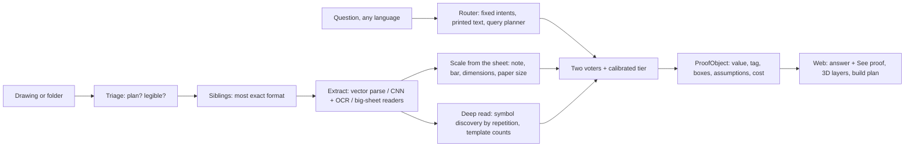

# Plumb: blueprints that show their work

**Ask a construction drawing a question in plain language (in any of 8 languages). Get the number, and see exactly
which elements on the drawing produced it.**

Junction 2026 · Stoa challenge *"Make Blueprints Talk"* · tech challenges: Verda Compute Track, Best use of Modal, Best Use of Gemini API, Best use of CRACI ·
[2-minute video](docs/SUBMISSION.md) · [pitch deck (PDF)](docs/pitch/Plumb_pitch_deck.pdf) ·
[web UI](https://plumb-blueprints.vercel.app) · **Reviewers:** [evaluation guide](docs/JUDGES.md) · [`llms.txt`](llms.txt) · [architecture](docs/ARCHITECTURE.md)

> Plumb is a geometry and verification layer for technical drawings, not a chatbot. Computer vision, OCR and fixed
> engineering formulas produce every number. A language model is used for two narrow jobs (naming a symbol type
> once, and turning a new question into a query that code runs), and it **never outputs a count or a measurement**.
> So a better model next year makes Plumb better instead of making it obsolete.

---

## By the numbers

| | |
|---|---|
| **6,192** | dataset questions scored end to end (DEV split; holdout never tuned on) |
| **24 / 25** | harder questions right on Stoa's three full-size construction sheets |
| **67 megapixels** | the largest sheet read in one pass: 139 doors, 84 chairs, 48 sinks, 48 toilets, 46 beds |
| **99.8%** | IFC areas within 2% (n = 816) |
| **0 tokens · 214 ms** | mean cost and time per answer in the latest accuracy run, on a laptop CPU |
| **1,219 calls · 2.2 M tokens · $9.35** | every open-weight model call made during the whole hackathon, logged one by one |
| **255** | automated tests, run on native amd64 **and** arm64 CRACI runners on every push |
| **8** | languages you can ask in |

## What it does

| You give it | You get |
|---|---|
| A scan, PNG, PDF, DXF, IFC, or a whole project folder | Triage first: floor plan, section, site plan, photo ("not a drawing") or unreadable, and a refusal with a reason when it can't read it |
| "How many doors?" / "Montako makuuhuonetta?" / "How many check valves?" | One sentence, **every counted element boxed on the drawing**, and a tag on each value: *drawn* (measured), *specified* (printed on the sheet), *chosen* (by you) or *defaulted* (an assumption, listed) |
| A sheet with a printed scale | The scale **read from the sheet itself** (scale note, graphic bar, dimension strings, paper size), cross-checked; a "Where?" button pins each piece of evidence |
| A sketch with no scale | Measure **one** thing you know (click both ends of a door, type 0.9 m) and every room size, wall length and area follows |
| A 10,000-pixel construction sheet | A **deep read**: every repeated symbol found by computer vision and counted (beds, chairs, sinks, toilets, doors, staircases, valves...), every room named, per wing, with thumbnails |
| Any plan | A 3D model with **layers like a body**: envelope, walls, furniture, piping, electrical. A **build plan**: concrete, doors, hinges, finishes, and pipe and cable estimated by European rules (EN 806-3, EN 12056-2, EN 12464-1), always labelled *estimate* |

## Measured results

Every number below comes from a report in this repo. The holdout split is never used for tuning.

| What | Result | Source |
|---|---|---|
| Harder questions on Stoa's three full-size sheets (piping M-101A, foundation S-100F, dormitory A-2) | **24 / 25** correct; scale within 2% on all three | [`docs/stress-report-r9.md`](docs/stress-report-r9.md) |
| CubiCasa5k scanned plans, exact counts (DEV sample, LLM off) | **81.5%** [77.4, 85.0] (n = 400), mean 214 ms, 0 tokens | [`docs/evidence/20261115-024003-gate_r9/report.md`](docs/evidence/20261115-024003-gate_r9/report.md) |
| Swiss Dwellings, exact counts (given file only) | **91.3%** [86.6, 94.4] (n = 206) | `docs/evidence/20261115-022504-gate_sw8/report.md` |
| Full DEV split, all sources (6,192 questions) | **75.0%** using sibling files, **70.4%** given file only | [`docs/evidence/…-w2-dev/`](docs/evidence/20261114-154539-w2-dev/report.md), [`…-w2-dev-nosib/`](docs/evidence/20261114-161203-w2-dev-nosib/report.md) |
| IFC models, areas (within 2%) | **99.8%** (n = 816) | same `w2-dev` report |
| Swiss Dwellings with the DXF sibling: counts / areas | **100%** / **97.7%** | same `w2-dev` report |
| Deep read of the 67-megapixel dormitory sheet | 139 doors, 84 chairs, 48 sinks, 48 toilets, 46 beds, 5 staircases; **about $0.08, once** (cached per file) | in-app receipt; [`docs/handoff/deep-sheets.md`](docs/handoff/deep-sheets.md) |

Scoring follows the dataset: counts must be exact; areas, lengths and volumes within 2%. Both numbers are always
reported: *given file only* and *with siblings* (the same drawing in a more exact format, e.g. DXF next to a PDF,
disclosed in `provenance.resolved_from`).

**Known limits (stated, not hidden):** symbol *names* can be wrong while counts are right (one-click rename); doors on
piping sheets are partial; some scanned-plan intents (windows, bedrooms) are weaker; Swiss areas without the DXF
sibling are weak. Low-agreement answers are shown amber ("needs a look"), never green.

## Why judges can trust a number

1. **No unsourced number.** Every scale anchor and assumption carries a tag (drawn, specified, chosen, defaulted,
   open), a source and what it depends on; every answer carries the elements that produced it. See [`contracts/proof.py`](contracts/proof.py), the single interface between engine, API and UI.
2. **Two independent voters per count.** Reliability tiers come from voter agreement, calibrated on DEV answers,
   never from a model's own confidence ([`engine/skeptic/`](engine/skeptic/)).
3. **No circular evidence.** If the scale only came from an assumed door width, sizes are reported as relative.
4. **Fail loudly.** Photos, elevations and illegible scans are refused in product mode, with the reason.
5. **The LLM never makes the number.** It is optional (`LLM_PROVIDER=none` by default), every call is logged in
   `Cost`, and extraction and voting make no network calls.

## Low inference cost

- Most answers: **0 tokens, $0.0000**, about 0.2 s, on a laptop CPU.
- A deep read of a huge sheet: two vision-model reviews to name the symbol types, about $0.08 for the dormitory sheet,
  once; re-reads are free (cached by file SHA-256).
- Pluggable providers: none (default), Verda / Featherless (open-weight models), Gemini, Anthropic.

## Open-weight models on our own endpoints (Verda / Modal-ready), on a hard budget

Plumb's model layer is one OpenAI-compatible client (`engine/query/llm.py` → `scripts/verda.py`) that talks to
open-weight models on endpoints we control: a Verda Inference API key (`VERDA_API_KEY`) or Modal endpoints
(`MODAL_TOKEN_ID` / `MODAL_TOKEN_SECRET`, one URL per model, cold starts handled). Every call is priced, appended to
`logs/verda_cost.jsonl`, and refused if it would cross the budget cap (`BUDGET_VERDA_USD`).

| | Model | Calls | Tokens (in / out) | Cost |
|---|---|---|---|---|
| fast | DeepSeek V4.1 Flash | 806 | 654 k / 78 k | $0.24 |
| strong | Kimi K3.1 Pro | 413 | 733 k / 764 k | $9.11 |
| **total** | | **1,219** | **2.2 M** | **$9.35** |

*Source: `logs/verda_cost.jsonl`, 2026-11-14 12:57 → 2026-11-15 07:47 (Helsinki).* Open-weight models on infrastructure
we choose means client drawings never have to go to a third-party model API.

**In the product, three jobs, never a number:**

1. **Two-reviewer scan check** (`engine/scancheck.py`). Before anything is built in 3D, a fast and a strong vision
   model each judge the sheet (numbered views, two wall-reader overlays) in a fixed JSON form. Their **consensus**
   labels the views and raises flags; code picks the walls. About **$0.0045 per sheet**, cached by SHA-256
   ([decision](docs/decisions/scan-check-reviewers.md)).
2. **Naming on the deep read** (`engine/symbols.py`). Computer vision finds and counts every repeated symbol; the
   models only name each *type*, in parallel, with a second focused pass for anything left unnamed.
3. **Query planner** (`engine/query/`). A question no template matches becomes a validated `query_spec` that code
   executes against the drawing's elements.

**In the build, the cheap model wrote code.** `scripts/verda_task.py` gives a cheap model one tightly scoped file to
write, checks it (syntax, then the tests), feeds errors back, retries, and stages the result for review before it can
land. `engine/sheet_findings.py` was produced this way: one attempt, 13.8 s (`logs/verda_tasks.jsonl`).

Per tech challenge (Verda, Modal, Gemini API, CRACI): [`docs/TECH_CHALLENGES.md`](docs/TECH_CHALLENGES.md).

## Google Gemini: a first-class, drop-in provider

Because models only name things and code measures, the model is swappable. Gemini is wired in through Google's
OpenAI-compatible endpoint (`engine/query/llm.py`):

```bash
LLM_PROVIDER=gemini        # GEMINI_API_KEY (or GOOGLE_API_KEY) in .env
# fast tier  -> gemini-2.5-flash     strong tier -> gemini-2.5-pro   (override with GEMINI_MODEL_FAST / _STRONG)
```

Same fixed-JSON prompts, same vision inputs, same cost ledger and budget cap, same "never produces a number" rule.
Switching from open-weight models to Gemini is one environment variable; the accuracy of counts and measurements
does not depend on which provider is on.

## How it works



Details, module by module: [`docs/ARCHITECTURE.md`](docs/ARCHITECTURE.md).

## Run it

```bash
make setup                                    # .venv + requirements (+ requirements-optional.txt for IFC, torch)
cp .env.example .env                          # DATASET_ROOT, optional LLM keys (never commit .env)
.venv/bin/python -m uvicorn api.main:app --port 8001          # engine (LLM_PROVIDER=none by default)
cd web && VITE_ENGINE=http://localhost:8001/api npm run dev    # http://localhost:5173
.venv/bin/python -m pytest -q                 # 255 passed, 18 skipped (dataset-dependent tests skip cleanly)
make eval                                     # reproduce the accuracy report (evalkit/out/<run>/report.md)
```

The hosted UI (https://plumb-blueprints.vercel.app) talks to an engine on `localhost:8001`. Not in git: the
CubiCasa5k weights (`weights/`, see `docs/HANDOFF.md`) and the dataset (`DATASET_ROOT`).

## Repository map

| Path | What is there |
|---|---|
| `contracts/proof.py` | The ProofObject contract (pydantic v2): value, evidence elements, voters, tier, scale, tagged assumptions, cost |
| `engine/pipeline.py` | The engine: cache, triage, siblings, extract, vote, tier, ProofObject |
| `engine/scale/` | Scale from the sheet (`sheet_scale.py`), anchors and the user's measurement (`anchors.py`) |
| `engine/symbols.py` | Deep read: symbol discovery, counting, naming, rooms and zones |
| `engine/sheet_lookup.py`, `engine/sheet_findings.py` | What the sheet itself prints (tags, schedules, notes), read back with a receipt |
| `engine/raster/`, `engine/vector/`, `engine/bigsheet.py`, `engine/outline.py` | Readers for scans, exact formats and big construction sheets |
| `engine/skeptic/`, `engine/triage/` | Second voter, calibration, refusal |
| `engine/query/` | Query engine for new questions (an LLM may draft the spec; code runs it) |
| `engine/layers.py`, `engine/takeoff/`, `engine/plan/` | Body-like layers, EU-rule service estimates, quantities and build plan |
| `api/main.py` | FastAPI service |
| `web/` | React + TypeScript + three.js UI |
| `evalkit/` | Scoring harness, deterministic DEV/holdout split, reports in `evalkit/out/` |
| `docs/` | [Evaluation guide](docs/JUDGES.md), [architecture](docs/ARCHITECTURE.md), [evidence](docs/evidence/) (the cited evaluation reports), stress reports, decisions, pitch |

## CI/CD on CRACI

Every push and pull request runs [`.github/workflows/ci.yml`](.github/workflows/ci.yml) entirely on CRACI runners.
Six jobs, each set up with `cracicorp/setup@v1`, a right-sized machine and its own network policy:

| Job | Runner | What it proves |
|---|---|---|
| `python (amd64)` | `ubuntu-24.04`, 4 vCPU | the full 255-test suite + the ProofObject contract check |
| `python (arm64)` | `craci-slim-arm`, 4 vCPU, **native arm64, no QEMU** | the same suite on the architecture most judges' laptops run |
| `web` | 4 vCPU | TypeScript typecheck + production build, `web/dist` uploaded as an artifact |
| `api smoke + security` | 2 vCPU | boots the real FastAPI server and **replays the attacks our own stress test found**: `/etc/passwd`, `../../etc/passwd`, `/proc/self/environ` must all return 400 |
| `egress lock proof` | 1 vCPU, `default: deny` + PyPI/GitHub presets | **tests the supply-chain lock instead of trusting it**: PyPI must be reachable, `example.com` must not |
| `summary` | 1 vCPU | writes a job summary of every result |

Design choices: **no secrets in CI** (dataset, weights, OCR and LLM tests skip cleanly, so there is nothing to leak
through a dependency); **a security bug found once stays fixed** (it becomes a CI probe); **pip and npm caches** keyed
on the lock files. On 2026-11-14 the egress job showed the lock was not yet in force on our project, so that job is
red and we say so, rather than claim a lock we could not verify.

## What's next

- **A provider bake-off in CI:** run the same deep read through Verda and Gemini and publish naming agreement and
  cost per sheet side by side.
- **Eval as a gate:** a nightly CRACI job that runs `make eval` on the DEV split and fails on any accuracy regression.
- **Verda as a review swarm:** more `verda_task` workers on scoped files, each one checked by tests before review.
- **Renaming in one click feeds back:** user corrections to symbol names become labelled data for the next read.
- **More sheet types:** electrical and HVAC schedules read the same way piping tags are today.

## Credits and licences

CubiCasa5K (Kalervo, Ylioinas, Haikiö, Karhu, Kannala, 2019), CC BY-NC-SA 4.0, non-commercial use only. Swiss Dwellings
v3.0.0 (Archilyse AG), CC BY 4.0. IFC sample models and Opening Design drawings under the licences listed in each
`data/<source>/LICENSE.md`. The credit for a drawing is shown whenever that drawing is shown.

Progress log: [issue #1](https://github.com/lalashutosh/constructionsite/issues/1) · `docs/HANDOFF.md`.
